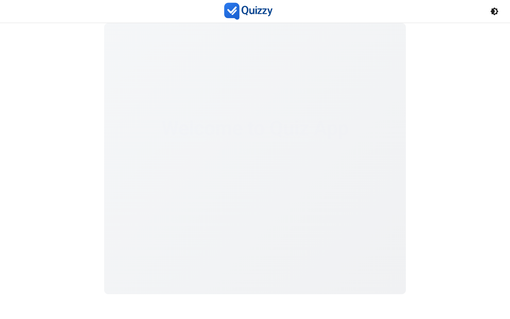
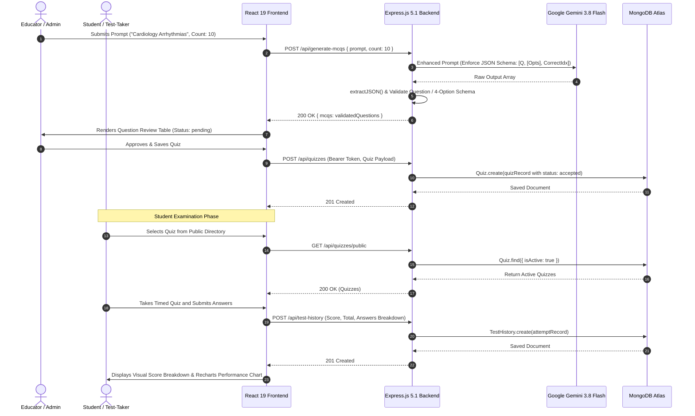

# 🧠 Quiz-Generator-Main — Enterprise AI MCQ Generation & Examination Platform

<div align="center">

### Full-Stack Examination Lifecycle System Powered by Google Gemini AI & React 19
*Automated question generation, pedagogical validation workflows, role-based administration, and comprehensive student performance analytics.*

[](https://github.com)
[](https://react.dev)
[](https://vitejs.dev)
[](https://mui.com)
[](https://nodejs.org)
[](https://expressjs.com)
[](https://mongodb.com)
[](https://ai.google.dev)
[](LICENSE)

</div>

---

## Application Screenshot & Interface Preview

<div align="center">
  
</div>

---

## 🌐 Suite 5 Ecosystem & Cross-Repository Links

**quiz-Generator--main** serves as the central full-stack production release within the **Suite 5 (Medical & AI Quiz Ecosystem)**. Explore the related repositories:

| Repository | Role | Core Technology | Link |
| :--- | :--- | :--- | :--- |
| **quiz-Generator--main** (This Repo) | Enterprise AI MCQ Backend & Full-Stack Platform | React 19 / Express 5 / MongoDB / Gemini 3.8 Flash | [quiz-Generator--main](file:///c:/Users/pandi/OneDrive/Desktop/github/quiz-Generator--main) |
| **mcq-main-frontend** | Production Web Exam Center & Analytics Portal | React 19 / Vite / Recharts / Vercel Host | [mcq-main-frontend](file:///c:/Users/pandi/OneDrive/Desktop/github/mcq-main-frontend) |
| **quiz-Generator-** | Foundational AI MCQ Algorithmic Core Prototype | Express / Google Generative AI / Vite Prototype | [quiz-Generator-](file:///c:/Users/pandi/OneDrive/Desktop/github/quiz-Generator-) |
| **DCP-QUIZZY** | Medical Mobile App Client & Licensing Engine | React Native / Expo 57 / Express / MongoDB | [DCP-QUIZZY](file:///c:/Users/pandi/OneDrive/Desktop/github/DCP-QUIZZY) |

---

## 📌 Executive Summary & Educational Impact

Traditional exam authoring is time-consuming, prone to human bias, and lacks immediate scalability across evolving academic curricula. Educative organizations, medical faculties, and certification boards require automated tools capable of translating syllabus topics and textbook excerpts into rigorous, psychometrically balanced multiple-choice questions.

**Quiz-Generator-Main** delivers an end-to-end examination platform combining:
1. **Intelligent Generative Authoring**: Leveraging **Google Gemini 3.8 Flash** to synthesize psychometrically structured question sets with four plausible distractors, verifiable correct answers, and clean JSON formatting.
2. **Quality Assurance Review Lifecycle**: An administrative gating system where generated questions enter a `pending` state, allowing subject matter experts (SMEs) to inspect, edit, accept, or reject questions before they enter public test banks.
3. **Role-Based Examination Portals**: Segregated user experiences for Students (taking timed quizzes, analyzing historical progress with Recharts charts, reviewing mistakes) and Educators/Admins (managing test banks, curating question pools).
4. **Resilient Data Architecture**: Built on Express 5, Mongoose 8, JWT-authenticated sessions, and local client state caching to guarantee high availability during peak examination sittings.

---

## 🚀 Key Features

- 🤖 **AI-Driven Question Synthesis**: Generates between 1 and 50 rigorous questions per prompt with automatic validation against 4-option schema specifications.
- 👨‍🏫 **Educator QA & Review Workflow**: Administrative review board supporting `pending`, `accepted`, and `rejected` triage, complete with question editing and batch actions.
- 📊 **Recharts Test Analytics & Trends**: Visual score distributions, topic mastery breakdowns, and historical chronological performance logs.
- ⏱️ **Exam Simulation Engine**: Timed testing environment simulating standardized testing conditions with unanswered question reminders and final submission verification.
- 🔐 **Dual Role Access Control (RBAC)**: Secure user and admin profiles enforced via bcrypt-hashed passwords and stateless JWT bearer tokens.
- 🎨 **Modern Material UI (MUI v7) Interface**: Clean, accessible component design featuring dark/light theme switching, responsive layouts, and fluid transitions.
- 🛡️ **Isolated Backend Architecture**: Self-contained `mcq-backend` service with hardened `.env` handling, CORS protection, and sanitized error envelopes.

---

## 🏛️ System Architecture

The following architectural diagram illustrates the interaction between the React 19 client, Express 5 server, Google Gemini AI, and MongoDB persistence layer:

```mermaid
flowchart TD
    subgraph Client["Frontend Client (React 19 + Vite + MUI v7)"]
        UI["Material-UI v7 Componentry"]
        Router["React Router v7 (Public & Protected Routes)"]
        AuthCtx["AuthContext (JWT Token & User State)"]
        QuizCtx["QuizContext (Active Session & Test Cache)"]
        ThemeCtx["ThemeContext (Dark / Light Theme Engine)"]

        subgraph Views["Application Views"]
            UserPages["User Views: TakeQuiz | MockQuiz | TestHistory | Results"]
            AdminPages["Admin Views: AdminDashboard | CreateQuiz | QuestionReview | ViewQuizzes"]
        end
    end

    subgraph BackendGateway["Backend Service (mcq-backend: Express.js 5.1)"]
        CORS["CORS & Body-Parser Middleware"]
        JWTVerify["JWT Authentication & RBAC Gatekeeper"]
        
        subgraph Controllers["Route Handlers & Endpoints"]
            AuthRoutes["/api/auth & /api/login, /api/register"]
            QuizRoutes["/api/quizzes & /api/quizzes/public"]
            HistRoutes["/api/test-history"]
            ProfRoutes["/api/profile & /api/auth/update-profile"]
            MCQGen["/api/generate-mcqs (Gemini Controller)"]
        end
    end

    subgraph DataAndAI["Databases & Cloud AI Services"]
        MongoDB[("MongoDB Atlas Database\n(Users, Quizzes, TestHistory)")]
        GeminiAPI["Google Gemini 3.8 Flash\n(Structured JSON Prompting)"]
    end

    UI --> Router
    Router --> AuthCtx
    Router --> Views
    Views --> QuizCtx
    Views --> ThemeCtx

    Views -->|"HTTP REST Requests / JSON"| CORS
    CORS --> JWTVerify
    JWTVerify --> AuthRoutes
    JWTVerify --> QuizRoutes
    JWTVerify --> HistRoutes
    JWTVerify --> ProfRoutes
    CORS --> MCQGen

    AuthRoutes --> MongoDB
    QuizRoutes --> MongoDB
    HistRoutes --> MongoDB
    ProfRoutes --> MongoDB
    MCQGen -->|"Enhanced Prompt + Schema"| GeminiAPI
    GeminiAPI -->>|"JSON Array [Q, [Options], AnsIdx]"| MCQGen
```

---

## 🔄 Data Flow & Sequence Diagram

This sequence demonstrates an educator prompting the Gemini AI engine to generate an assessment set, inspecting and approving questions, and a student completing the test:



---

## 🛠️ Complete Tech Stack Breakdown

| Layer | Technology | Version | Purpose / Architectural Responsibility |
| :--- | :--- | :--- | :--- |
| **Frontend Framework** | React | `^19.1.1` | Concurrent rendering, modern hooks, and component composition |
| **Build Tooling** | Vite | `^7.1.2` | Ultra-fast Hot Module Replacement (HMR) and optimized rollup bundler |
| **Component Library** | Material-UI (MUI) | `^7.3.1` | Comprehensive accessible UI components, dialogs, and tables |
| **Styling Engine** | Emotion React & Styled | `^11.14` | CSS-in-JS style encapsulation and theme propagation |
| **Data Visualization** | Recharts | `^3.1.2` | Declarative charting for historical test scores and topic trends |
| **Client Routing** | React Router DOM | `^7.8.0` | Client-side routing, protected auth routes, and error boundaries |
| **HTTP Client** | Axios | `^1.11.0` | Promise-based HTTP client for API communication |
| **Client Storage** | LocalForage | `^1.10.0` | Asynchronous browser IndexedDB/LocalStorage abstraction |
| **Backend Framework** | Express.js | `^5.1.0` | Next-generation Node.js server framework with modernized async routing |
| **Database & ODM** | MongoDB / Mongoose | `^8.18.0` | Strict schema validation, compound indexes, and relational refs |
| **AI Generation** | `@google/generative-ai` | `^0.24.1` | Google Gemini 3.8 Flash SDK for high-speed prompt execution |
| **Authentication** | JSON Web Tokens (JWT) | `^9.0.2` | Stateless signed tokens for role verification (user vs admin) |
| **Password Security** | bcryptjs | `^3.0.2` | Adaptive salt rounds for secure password hashing |

---

## 📂 Repository Directory Structure

```text
quiz-Generator--main/
├── .env                            # Client environment configuration
├── .gitignore                      # Git ignore rules (includes .env & mcq-backend/.env)
├── eslint.config.js                # ESLint 9 configuration
├── index.html                      # Single page application HTML entry
├── package.json                    # Frontend dependencies and Vite build scripts
├── vite.config.js                  # Vite configuration and React plugin
│
├── mcq-backend/                    # Express.js REST API service
│   ├── .env.example                # Sanitized environment configuration template
│   ├── .gitignore                  # Backend-specific ignore rules (protects credentials)
│   ├── package.json                # Server dependencies (Express 5, Mongoose, Gemini)
│   └── server.js                   # Unified API server, Schemas, Auth & Gemini Controller
│
└── src/                            # React 19 client application source
    ├── App.css                     # Global custom styles
    ├── App.jsx                     # Root application routing configuration
    ├── index.css                   # Baseline typography and CSS reset
    ├── main.jsx                    # Application bootstrap and theme mounting
    │
    ├── components/                 # Component hierarchy
    │   ├── admin/                  # Administrative & Review Suite
    │   │   ├── AdminDashboard.jsx  # Overview metrics, quiz counts, and recent activity
    │   │   ├── CreateQuiz.jsx      # Manual & AI quiz creation wizard
    │   │   ├── EditQuiz.jsx        # Quiz metadata and question editor
    │   │   ├── QuestionForm.jsx    # Individual question creation component
    │   │   ├── QuestionList.jsx    # Paginated question directory with edit controls
    │   │   ├── QuestionReview.jsx  # Question triage workflow (pending/accept/reject)
    │   │   └── viewQuizzes.jsx     # Comprehensive quiz management table
    │   ├── auth/                   # Authentication forms
    │   │   ├── Login.jsx           # Sign-in form with JWT acquisition
    │   │   └── Register.jsx        # Account registration with role selection
    │   ├── common/                 # Reusable layout and navigation components
    │   │   ├── Layout.jsx          # Master application layout wrapper
    │   │   ├── Navbar.jsx          # Dynamic navigation bar with role toggles
    │   │   ├── Profile.jsx         # User profile and password management
    │   │   ├── ProtectedRoute.jsx  # Role-gated route enforcement
    │   │   └── PublicRoute.jsx     # Public visitor route handler
    │   └── user/                   # Student & Test-Taker interfaces
    │       ├── MockQuiz.jsx        # Quick practice simulation mode
    │       ├── Quiz.jsx            # Active quiz taking container
    │       ├── Results.jsx         # Post-test assessment summary
    │       ├── TakeQuiz.jsx        # Timed test-taking interface with timer
    │       ├── TestHistory.jsx     # Chronological test log with Recharts graphs
    │       ├── UserDashboard.jsx   # Personalized student home dashboard
    │       └── ViewResult.jsx      # In-depth question-by-question review
    │
    ├── contexts/                   # React Context Providers
    │   ├── AuthContext.jsx         # User credentials, JWT storage, role verification
    │   ├── QuizContext.jsx         # Active quiz state, timer, answer map
    │   └── ThemeContext.jsx        # Material-UI dynamic light/dark theme provider
    │
    ├── hooks/                      # Custom React Hooks
    │   ├── useAuth.js              # Hook for consuming AuthContext
    │   └── useQuiz.js              # Hook for consuming QuizContext
    │
    ├── pages/                      # Top-level route pages
    │   ├── Home.jsx                # Landing page introducing the platform
    │   ├── NotFound.jsx            # 404 Error page
    │   ├── Unauthorized.jsx        # 403 Access denied page
    │   └── api/                    # In-browser client fallback endpoints
    │       └── generate-questions.js
    │
    ├── services/                   # Service layer for external APIs
    │   ├── api.js                  # Direct AI prompt invocation service
    │   ├── auth.js                 # Authentication client (login, register)
    │   └── quiz.js                 # Quiz operations service
    │
    └── utils/
        └── storage.js              # LocalStorage and LocalForage wrappers
```

---

## ⚡ Local Setup & Installation

### 1. Prerequisites
- **Node.js**: v20.x or higher installed (`node -v`)
- **npm** or **yarn**: npm v9+ recommended
- **MongoDB**: Active MongoDB Atlas connection string or local MongoDB instance running on `mongodb://localhost:27017`
- **Google Gemini API Key**: Obtainable from [Google AI Studio](https://aistudio.google.com/)

---

### 2. Backend Setup (`mcq-backend`)

1. Navigate to the backend directory:
   ```bash
   cd mcq-backend
   ```

2. Copy the sanitized `.env.example` file to create `.env`:
   ```bash
   cp .env.example .env
   ```

3. Fill in your environment variables in `mcq-backend/.env`:
   ```env
   # Google Gemini API Key
   GEMINI_API_KEY=your_gemini_api_key_here

   # MongoDB Connection String
   MONGODB_URI=mongodb+srv://<username>:<password>@cluster0.mongodb.net/quizdb?retryWrites=true&w=majority

   # JWT Secret Key
   JWT_SECRET=your_super_secret_jwt_key_here_minimum_32_chars

   # Port (Default: 5000)
   PORT=5000
   ```

4. Install backend dependencies and launch the server:
   ```bash
   npm install
   node server.js
   # Output:
   # MongoDB connected successfully
   # Server running on port 5000
   ```

---

### 3. Frontend Setup (`src`)

1. Open a new terminal and return to the root folder:
   ```bash
   cd ..
   ```

2. Verify or create the client `.env` file:
   ```env
   REACT_APP_API_URL=http://localhost:5000
   VITE_API_URL=http://localhost:5000
   ```

3. Install frontend dependencies:
   ```bash
   npm install
   ```

4. Start the Vite development server:
   ```bash
   npm run dev
   # Server running at: http://localhost:5173/
   ```

5. Access the application in your browser at `http://localhost:5173`. Register an account to explore both Student and Admin examination workflows!

---

## 📡 API Reference Table

The `mcq-backend` server provides clean JSON endpoints mounted at `/api`:

| Method | Endpoint | Description | Auth Required | Parameters / Body |
| :--- | :--- | :--- | :---: | :--- |
| `POST` | `/api/register` | Register new user or administrator account | No | `{ firstName, lastName, email, username, password, role }` |
| `POST` | `/api/login` | Authenticate user and obtain JWT token | No | `{ username, password }` |
| `GET` | `/api/auth/profile` | Retrieve profile of the currently logged-in user | **Yes (Bearer)** | None |
| `PUT` | `/api/auth/update-profile` | Update account details (name, email) | **Yes (Bearer)** | `{ firstName, lastName, email }` |
| `PUT` | `/api/auth/change-password` | Securely change user password | **Yes (Bearer)** | `{ currentPassword, newPassword }` |
| `POST` | `/api/generate-mcqs` | Generate structured MCQs via Gemini AI | No | `{ prompt: string, count: number (1-50) }` |
| `POST` | `/api/quizzes` | Create a new quiz with question set | **Yes (Bearer)** | `{ name, topic, difficulty, questions, questionCount }` |
| `GET` | `/api/quizzes/public` | Fetch all active public quizzes for testing | **Yes (Bearer)** | None |
| `GET` | `/api/quizzes` | Fetch quizzes created by the authenticated user | **Yes (Bearer)** | None |
| `GET` | `/api/quizzes/:id` | Retrieve single quiz details by ID | **Yes (Bearer)** | URL parameter `:id` |
| `PUT` | `/api/quizzes/:id` | Update quiz title, topic, or question statuses | **Yes (Bearer)** | `{ name, topic, difficulty, questions, isActive }` |
| `DELETE`| `/api/quizzes/:id` | Delete a quiz owned by the user | **Yes (Bearer)** | URL parameter `:id` |
| `POST` | `/api/test-history` | Persist a completed student exam attempt | **Yes (Bearer)** | `{ quizId, quizName, date, score, total, topic, difficulty, answers }` |
| `GET` | `/api/test-history` | Fetch historical test records of authenticated user | **Yes (Bearer)** | None |
| `DELETE`| `/api/test-history/:id` | Delete a specific historical test entry | **Yes (Bearer)** | URL parameter `:id` |
| `GET` | `/api/profile` | Retrieve aggregate statistics and attempt totals | **Yes (Bearer)** | None |

---

## 🚢 Production Deployment

### Backend Deployment (Node.js / Render / Railway / Heroku)
1. Set the root build directory to `mcq-backend`.
2. Configure build command: `npm install`
3. Configure start command: `node server.js`
4. Set Environment Variables:
   - `GEMINI_API_KEY`
   - `MONGODB_URI`
   - `JWT_SECRET`
   - `PORT=5000`

### Frontend Deployment (Vercel / Netlify / Cloudflare Pages)
1. Set build directory to root.
2. Build command: `npm run build`
3. Output directory: `dist`
4. Environment Variables:
   - `VITE_API_URL=https://your-deployed-backend.com`
   - `REACT_APP_API_URL=https://your-deployed-backend.com`

---

## 🛡️ Security, Performance & Best Practices

- **Strict Credential Protection**: Both root and backend `.gitignore` rules strictly prevent accidental commits of `.env` files. A sanitized `.env.example` provides explicit onboarding documentation without credential leakage.
- **Robust Schema Parsing**: The `/api/generate-mcqs` controller applies both primary JSON parsing and markdown regex fallback extraction to handle AI generation inconsistencies without throwing unhandled exceptions.
- **Stateless JWT Authorization**: All sensitive quiz operations, student histories, and profile updates require cryptographically verified bearer tokens, preventing unauthorized session hijacking.
- **Password Hashing**: User passwords are never stored in plaintext; `bcryptjs` is utilized with 10 salt rounds before saving to MongoDB.
- **Client Render Efficiency**: Material-UI components are coupled with React 19 memoization and responsive grid systems to ensure low memory footprints on lower-spec client hardware.

---

## 📄 License

This project is licensed under the **MIT License** — see the [LICENSE](LICENSE) file for full details.

---

<div align="center">
  <sub>Part of the <b>Suite 5 Medical & AI Quiz Ecosystem</b>. Built with ❤️ for educators, medical professionals, and students.</sub>
</div>
